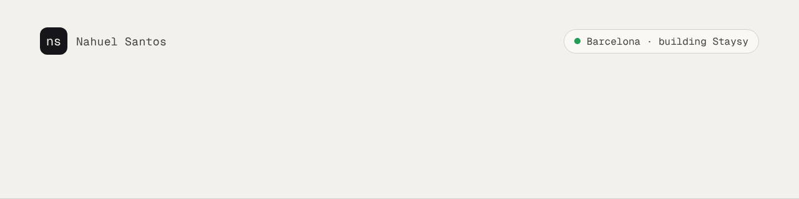
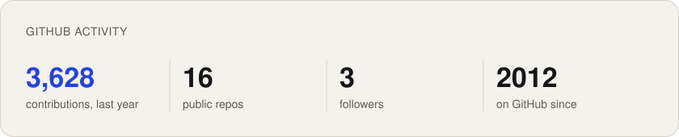
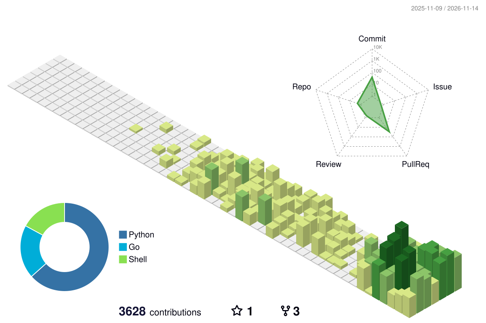

<!-- Generated from nahuelsantos/cv by scripts/build_profile.py on each release. Do not edit here. -->
<picture>
  <source media="(prefers-color-scheme: dark)" srcset="assets/banner-dark.gif">
  
</picture>

  <a href="https://linkedin.com/in/nahuelsantos"><picture><source media="(prefers-color-scheme: dark)" srcset="assets/button-linkedin-dark.svg"></picture></a>
  <a href="https://nahuelsantos.com"><picture><source media="(prefers-color-scheme: dark)" srcset="assets/button-website-dark.svg"></picture></a>
  <a href="https://cv.nahuelsantos.com/"><picture><source media="(prefers-color-scheme: dark)" srcset="assets/button-cv-dark.svg"></picture></a>

Software engineer, 15+ years across Argentina, New Zealand and Spain. Backends, integrations, and lately my own product on infrastructure I run myself.

Right now I'm building **[Staysy](https://staysy.co)**: An app-free guidebook for short-term rental hosts.

### This week

- Wisp is live: a bluffing card game on truco rules, with invite links, AI opponents that bluff back, and rules a simulator helped choose. ([wisp](https://github.com/nahuelsantos/wisp/pull/22))
- playthis.today is now a small pixel-art arcade, and you can see the other visitors walking around the room. ([arcade](https://github.com/nahuelsantos/playthis.today/pull/5))
- Holarchy 0.1: my AI agent on a USB stick, with encrypted memory synced over git, on Linux, macOS and Windows. ([holarchy](https://github.com/nahuelsantos/holarchy/pull/16))

### Featured projects

| Project | What it is | Status | Stack | Since |
| --- | --- | --- | --- | --- |
| [Staysy](https://staysy.co) | An app-free guidebook for short-term rental hosts. | live | GO · POSTGRES · HTMX | 2026 |
| Holarchy | Your personal AI agent on a USB stick, as a single Go binary. | building | GO · CRYPTO · GIT SYNC | 2026 |
| Homelab Platform | Three machines of my own run my sites, their databases and an AI agent in production. | live | DOCKER · GARM · LGTM | 2026 |
| [Wisp](https://wisp.playthis.today) | A bluffing card game on Argentine truco rules, with a Go server and a Svelte client. | live | GO · SVELTE · WEBSOCKETS | 2026 |
| Local AI Stack and Agent | llama.cpp serving Qwen3.5-9B on my own hardware; it powers the guide assistant in app.staysy.co. | live | LLAMA.CPP · RAG · CHROMA | 2026 |
| [Play This Today Arcade](https://playthis.today) | A pixel-art arcade room that is the front door to my browser games. | live | PHASER · TYPESCRIPT · NGINX | 2026 |
| [The Game](https://tg.playthis.today) | A viral web app: open the link, lose The Game, then generate your own link to pass it on. | live | GO · SQLITE | 2024 |
| Stray Paws | A persistent virtual-pet world where stray animals live, breed and grow old on the server around the clock. | building | GO · PHASER · POSTGRES | 2026 |
| Personal CV Website | This site: my landing page, CV and blog, generated from JSON and Markdown into static bilingual pages (English and Spanish) by a small Python builder, with RSS, sitemaps and ATS-friendly PDFs whose text layer is verified on every build. | live | PYTHON · JINJA2 · FASTAPI | 2021 |

### Skills

- **Core Languages**: C# (.NET Core/Framework) · Go · JavaScript/TypeScript · Python
- **Frontend**: React · React Native · HTML5/CSS3 · Svelte · Phaser · htmx · Next.js
- **Backend & Architecture**: Microservices · gRPC · REST APIs · Event-Driven Systems · Domain-Driven Design · FastAPI · WebSockets / real-time · Payments (Stripe)
- **Cloud & DevOps**: AWS · Kubernetes · Docker · Terraform · CI/CD · Azure DevOps · Linux · GitHub Actions (self-hosted, GARM, Incus) · Cloudflare (Tunnel, Access) · Traefik · Supply-chain security (SBOM, provenance, pinned actions) · Backups & restore drills (restic, Backblaze B2)
- **Databases**: SQL Server · DynamoDB · Redis · PostgreSQL · SQLite
- **Testing & Security**: Playwright (end-to-end) · Fuzz & property-based testing · Web security (CSP, OAuth/PKCE, SSRF) · Applied cryptography (age, Ed25519)
- **Observability**: Datadog · Sentry · Prometheus · Grafana · Loki · Tempo · Alerting (Alertmanager, SLO burn rates) · Logging
- **AI & LLMs**: LLM integration (llama.cpp) · RAG & embeddings · AI-assisted development (Claude Code) · LLM evaluation & grounded answers

### Activity

<picture>
  <source media="(prefers-color-scheme: dark)" srcset="https://raw.githubusercontent.com/nahuelsantos/nahuelsantos/output/stats-dark.svg">
  
</picture>

<picture>
  <source media="(prefers-color-scheme: dark)" srcset="https://raw.githubusercontent.com/nahuelsantos/nahuelsantos/output/contrib-3d-dark.svg">
  
</picture>

Activity graphics refresh daily on my own runners.

<b>My story</b>

 

| Year | Milestone |
| --- | --- |
| 2026 | Founder & CTO at Staysy |
| 2023 | Senior Software Engineer at AilyLabs |
| 2022 | Senior Software Engineer at Milestone Systems |
| 2021 | Senior Software Engineer at Xero |
| 2017 | Deep Learning Specialization, Coursera (deeplearning.ai) |
| 2016 | Self-Driving Car Engineer Nanodegree, Udacity |
| 2015 | Solutions Developer / Lead / Architect at Sandfield |
| 2013 | Senior Software Engineer at Fiscalgis |
| 2012 | Master's Degree, Software Engineering, Universidad Nacional de La Plata (UNLP) |
| 2010 | Software Engineer / Lead at Infomeda |
| 2009 | Junior Software Engineer at Snoop Consulting |
| 2008 | Junior Software Engineer / De Facto Lead at Softtek |
| 2005 | Engineering Degree, Systems Information Engineering, Universidad Tecnológica Nacional (UTN) |

Generated from the data behind [nahuelsantos.com](https://nahuelsantos.com). En español: [nahuelsantos.com/es/](https://nahuelsantos.com/es/).
